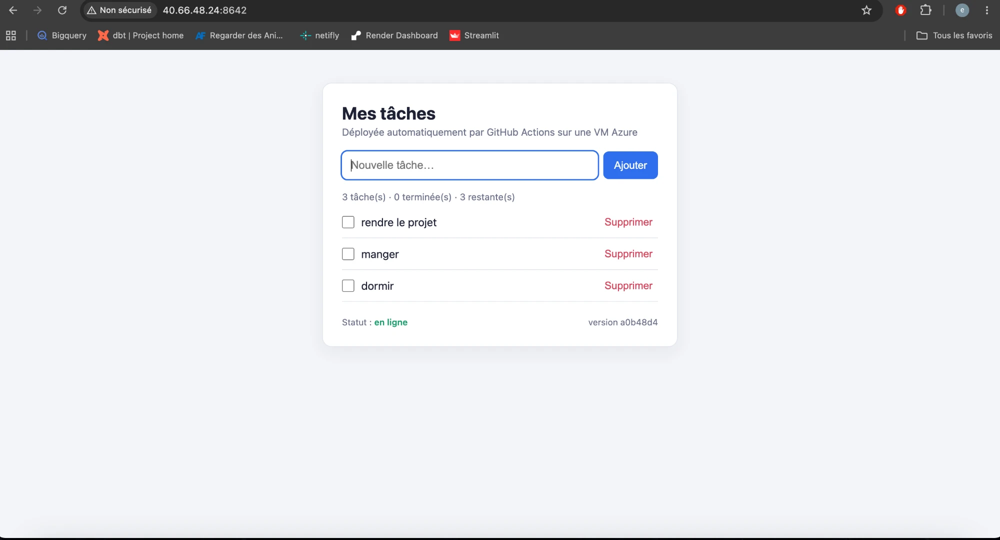
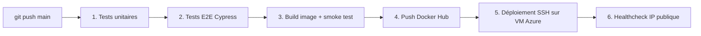

# TP CI/CD — GitHub Actions → Docker Hub → VM Azure


Application **Todo** (API REST + page web) en Node.js / Express, testée, conteneurisée
et déployée automatiquement sur une VM Azure à **chaque push sur `main`**, sans aucune action manuelle.

**Application en ligne :** http://40.66.48.24:8642 — healthcheck : http://40.66.48.24:8642/health



---

## L'application

| Méthode  | Route              | Rôle                                         |
| -------- | ------------------ | -------------------------------------------- |
| `GET`    | `/health`          | Vérification : `{status, version, uptime}`   |
| `GET`    | `/`                | Page web de gestion des tâches               |
| `GET`    | `/api/todos`       | Liste des tâches + statistiques              |
| `POST`   | `/api/todos`       | Crée une tâche `{ "title": "..." }`          |
| `GET`    | `/api/todos/:id`   | Détail d'une tâche                           |
| `PATCH`  | `/api/todos/:id`   | Modifie `title` et/ou `done`                 |
| `DELETE` | `/api/todos/:id`   | Supprime une tâche                           |

Le champ `version` de `/health` contient le SHA court du commit déployé : on sait
toujours exactement quelle version tourne en production.

```
src/          code de l'application (todoStore = logique métier, app = routes, server = démarrage)
public/       page web (HTML/CSS/JS sans framework)
tests/unit/   tests unitaires Jest + Supertest
cypress/e2e/  tests E2E Cypress (API + navigateur)
scripts/      deploy.sh, exécuté sur la VM via SSH
infra/        création de la VM Azure (Azure CLI + cloud-init)
.github/      pipeline GitHub Actions
```

## Fonctionnement du pipeline

Fichier : [`.github/workflows/ci-cd.yml`](.github/workflows/ci-cd.yml)



| Job | Ce qu'il fait | Échoue si… |
| --- | --- | --- |
| **1) Tests unitaires** | `npm ci` puis `npm test` (Jest, 28 tests) | un test échoue |
| **2) Tests E2E** | `npm run test:e2e` : démarre l'app, attend `/health`, lance Cypress (6 tests : disponibilité, CRUD API, parcours navigateur) | un test échoue |
| **3-4) Build & push** | `docker build` avec la version injectée, démarre l'image et interroge `/health` (smoke test), puis `docker push` des tags `<sha>` et `latest` | le build ou le smoke test échoue |
| **5-6) Deploy** | se connecte en SSH à la VM, exécute `scripts/deploy.sh` (pull + redémarrage idempotent), puis vérifie depuis Internet que `http://<IP>:8642/health` renvoie `status: ok` **et** la version du commit | la VM ne répond pas ou une ancienne version tourne encore |

Les jobs sont chaînés par `needs:` : l'image n'est construite et publiée **que si les tests
unitaires et E2E sont verts**, et le déploiement n'a lieu que si l'image a été publiée.

### Déclenchement

```yaml
on:
  push:
    branches: [main]
```

Un `git push` sur `main` (ou le merge d'une pull request) lance toute la chaîne.
Relancer le workflow depuis l'onglet *Actions* (« Re-run all jobs ») redéploie la même version.

### Tags de l'image

- `<utilisateur>/tp-cicd-app:<sha7>` — tag **immuable**, c'est celui qui est déployé
  (traçabilité, rollback possible en redéployant un ancien SHA) ;
- `<utilisateur>/tp-cicd-app:latest` — pointe toujours vers la dernière version validée.

### Déploiement idempotent

`scripts/deploy.sh` est envoyé à la VM par `ssh user@vm 'bash -s' < scripts/deploy.sh` :

1. installe Docker s'il est absent (VM neuve) ;
2. `docker pull` de l'image du commit ;
3. compare l'image du conteneur `ethannoe-tp-cicd` existant à l'image cible :
   - **identique et démarré** → rien n'est redémarré, l'état est simplement confirmé ;
   - **différente** → `docker rm -f ethannoe-tp-cicd` puis `docker run --name ethannoe-tp-cicd --restart unless-stopped -p 8642:3000` ;
4. attend que `http://localhost:8642/health` réponde (sinon affiche les logs et échoue) ;
5. supprime les anciennes versions de l'image pour ne pas remplir le disque.

Le nom de conteneur fixe garantit qu'il n'existe **jamais plus d'un conteneur**, quel que soit
le nombre d'exécutions. Le `concurrency: production` du job empêche deux déploiements simultanés.

**VM partagée :** la VM accueille aussi les applications d'autres élèves. Au lieu du `myapp` / port 80
suggéré, le conteneur a donc un nom propre au projet (`ethannoe-tp-cicd`) et un port dédié (`8642`),
définis dans les variables `CONTAINER_NAME` et `HOST_PORT` du workflow. Le déploiement ne touche
jamais aux autres conteneurs : il ne supprime que ce conteneur et les anciennes versions de cette image.

## Gestion des secrets

Aucun identifiant n'est dans le dépôt. Tout passe par **GitHub Secrets**
(*Settings → Secrets and variables → Actions*) :

| Secret | Contenu |
| --- | --- |
| `DOCKERHUB_USERNAME` | identifiant Docker Hub |
| `DOCKERHUB_TOKEN` | *Personal Access Token* Docker Hub (Read & Write), pas le mot de passe |
| `VM_HOST` | IP publique de la VM |
| `VM_USER` | utilisateur SSH (ici `ubuntu`) |
| `VM_SSH_KEY` | clé **privée** SSH dédiée au déploiement |

Les secrets sont passés aux scripts via des variables d'environnement (jamais interpolés
directement dans les commandes), la clé privée est supprimée du runner en fin de job,
et le token Docker Hub ne quitte jamais GitHub Actions : la VM télécharge une image publique.

Mise en place pas à pas (VM, clé SSH, token, secrets) : **[docs/SETUP.md](docs/SETUP.md)**.

## Choix techniques

- **Node.js 24 LTS + Express 5** : léger, démarrage instantané, idéal pour une API de démonstration.
  La logique métier (`todoStore.js`) est séparée des routes pour être testée unitairement.
- **Jest + Supertest** pour les tests unitaires : l'application Express est testée en mémoire,
  sans ouvrir de port.
- **Cypress** pour les E2E : il teste à la fois l'API HTTP (`cy.request`) et un vrai parcours
  utilisateur dans un navigateur (ajout, validation, suppression d'une tâche).
  `start-server-and-test` démarre l'app et attend `/health` : une seule commande en local comme en CI.
- **Dockerfile multi-étapes** sur `node:24-alpine` : uniquement les dépendances de production,
  exécution en utilisateur non-root `node`, `HEALTHCHECK` intégré, gestion de `SIGTERM`.
- **Smoke test avant le push** : une image qui ne démarre pas n'arrive jamais sur Docker Hub.
- **SSH natif + script versionné** plutôt qu'une action tierce : le déploiement est lisible,
  testable localement et ne dépend d'aucun code externe ayant accès à la clé SSH.
- **`docker run` avec nom fixe** plutôt que compose sur la VM : un seul conteneur, aucun fichier
  à copier sur le serveur. Un `docker-compose.yml` est fourni pour le lancement local.
- **Vérification de la version** après déploiement : on ne vérifie pas seulement que « quelque
  chose » répond, mais que c'est bien le commit qui vient d'être poussé.

Limites assumées : stockage en mémoire (les tâches sont perdues au redémarrage du conteneur),
courte interruption (~2 s) lors du remplacement du conteneur, HTTP sans TLS.

## Lancer en local

```bash
npm install
npm start               # http://localhost:3000
npm test                # tests unitaires
npm run test:e2e        # tests E2E (démarre l'app automatiquement)
```

Avec Docker :

```bash
docker compose up --build    # http://localhost:3000
# ou
docker build -t tp-cicd-app . && docker run -d --name myapp -p 3000:3000 tp-cicd-app
```
